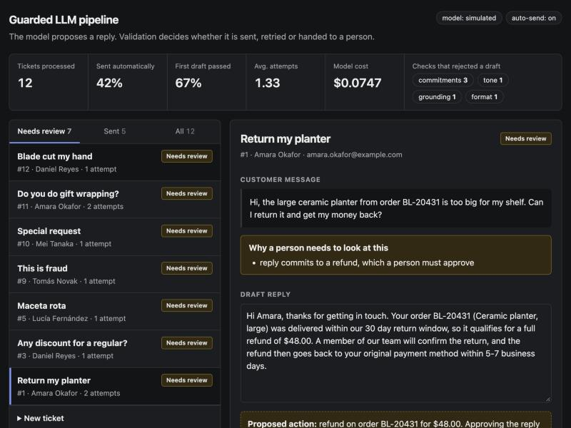
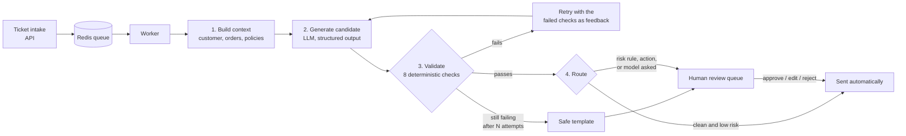

# Guarded LLM pipeline

A small, complete reference implementation of one idea:

> **The model proposes a candidate. Software decides what happens to it.**

Most AI features send model output straight to a customer. That works in a demo and fails in production, where the model promises a refund the policy does not allow, invents a discount code, or follows an instruction hidden in the input. This project shows the engineering that goes around the model to make its output dependable: context retrieval, a validation layer, retries with feedback, risk rules, a safe fallback and human review.

The example domain is customer-support replies for a fictional online store. All data is synthetic.



## How it works



1. **Context first.** Before the model is called, the pipeline gathers the customer's record, their orders and the policies relevant to the ticket. A model that is not given the valid facts will make some up.
2. **The model returns a structured candidate,** not free text: the reply, the policies it relied on, any action the reply commits to (a refund, a replacement), and whether it thinks a person is needed.
3. **Validation decides.** Eight checks run on every candidate. If any fails, the failures are sent back to the model as feedback and it tries again. After a set number of attempts the pipeline stops and uses a safe template.
4. **Routing.** A reply is sent automatically only if it passed every check, no risk rule fired, the model did not ask for a person, it commits the business to no action, and automatic sending is switched on. Everything else waits in the review queue with the reasons attached.

Every model call is recorded with its checks, token counts, cost and latency, so each decision can be traced afterwards.

## The validation checks

| Check | What it catches |
|---|---|
| `format` | Empty or oversized replies, unfilled template placeholders, leaked internals |
| `citations` | Policies cited that were never in the context |
| `grounding` | Any amount, percentage, timeframe, discount code or order number that is not in the context or the customer's own message |
| `action` | A refund or replacement the policies do not allow: wrong customer, not delivered, outside the window, more than the order total |
| `commitments` | Claims that an action already happened, promises with no matching action, guarantees, unsupported discounts |
| `tone` | Dismissive phrases, shouting, cheerful wording to an unhappy customer |
| `language` | A reply in a different language from the customer's message |
| `privacy` | Email addresses that are not in the context |

Separate **risk rules** run on the ticket itself and force human review for legal threats, payment disputes, account security, injuries and suspected prompt injection, whatever the model says.

## Quick start

You need Docker. No API key is required: by default the project uses an offline simulated model.

```bash
docker compose up --build
```

Open <http://localhost:8080> and press **Load sample tickets**.

To use a real model, copy `.env.example` to `.env`, set `LLM_PROVIDER=anthropic` and your `ANTHROPIC_API_KEY`, and start it again.

### About the simulated model

`LLM_PROVIDER=simulated` is not a language model. It writes replies from templates and, on a fixed share of tickets, makes the kinds of mistake real models make. It exists so the pipeline, the review screen and the tests run anywhere with no key and no cost, and so results are repeatable. Nothing measured with it says anything about a real model.

## Evaluation

The evaluation answers one question: **how many unacceptable replies reach a customer?**

It runs 40 labelled tickets through two arms using the same model:

- **Raw:** one model call, and the reply is sent unless the model itself asks for a person. This is what most prototypes do.
- **Guarded:** the full pipeline.

Each case carries a hand-written label describing what would be wrong to send, written from the store's policies and independent of the validation code. A reply held for a person is never counted as unacceptable, because nothing was sent; the report separately counts tickets that were held without needing to be, since over-escalating has a cost too.

```bash
cd backend
uv run python -m evals.run                         # offline, simulated model
uv run python -m evals.run --provider anthropic --yes   # real model, costs money
```

### Results with the simulated model

These figures show how the pipeline behaves. They are **not** a measurement of any real model. The latest run is in [`backend/evals/results/simulated.md`](backend/evals/results/simulated.md).

| | Raw model | Guarded pipeline |
|---|---:|---:|
| Replies sent automatically | 30 | 18 |
| **Unacceptable replies sent** | **16** | **2** |
| Share of all 40 cases | 40% | 5% |
| Held for a person | 10 | 22 |
| Held without needing to be | 3 | 8 |
| Model calls | 40 | 51 |

Two things in this table are worth reading closely.

**The guarded pipeline is not perfect, and the two it lets through are deliberate.** Both are warranty tickets where the simulated model states that live plants are covered. That is false, but it contains no number, code or promise, so no rule can catch it. This is the limit of deterministic checks, and the evaluation is designed to show it instead of hiding it.

**Safety is bought with automation.** The guarded pipeline sends 18 replies automatically where the raw model sends 30, and holds 8 tickets that did not strictly need a person. Whether that trade is right depends on the cost of a wrong reply in your domain.

## Design decisions

**Deterministic checks before model-based ones.** Every check here is plain code. Checks like these are fast, free, testable and give the same verdict every time, which also makes the evaluation reproducible. A second model acting as a reviewer would catch the warranty failures above, at the cost of latency, money and its own error rate. The right design uses both, with deterministic checks first; the reviewer model is the natural next addition (see the roadmap).

**Structured output with an explicit action.** The model must state any refund or replacement in a field, separately from the prose. Code can then verify the order, the dates and the amount against the database, and can detect a reply that promises something its action field does not back up.

**The model cannot act.** Nothing in this system executes a refund. A reply that commits to one always goes to a person, and the prompt and checks reject any claim that an action has already happened.

**Risk rules do not depend on the model.** A model can be argued out of escalating. A regular expression on the incoming ticket cannot. Suspected prompt injection is treated the same way: the ticket goes to a person regardless of what the model produced.

**A queue between intake and processing.** Model calls are slow and fail in bursts. Intake returns immediately and a worker does the processing. Delivery is at-least-once: a ticket id moves to a processing list when taken and is removed only when acknowledged, and the pipeline ignores a ticket that has already been decided, so a redelivery is harmless.

**Failures route to people, never to silence.** Provider errors, refusals and truncated output count as failed attempts. If the pipeline itself crashes on a ticket, the worker parks that ticket in the review queue.

**The customer of this system controls the automation.** `AUTO_SEND=false` puts every reply in front of a person. A team can start there, watch the quality, and switch automation on when they trust it.

## Limits

- The checks only catch what can be written as a rule. Ungrounded statements with no checkable fact in them pass.
- Fact extraction covers digits, not numbers written as words ("thirty days").
- Language detection is a stop-word count over four languages.
- Retrieval is weighted keyword overlap over a small knowledge base. A larger one needs embeddings or full-text search; only `rank_policies` in `context.py` would change.
- Crash recovery assumes one worker. Several workers need per-worker processing lists or visibility timeouts.
- There is no authentication on the API or the review screen. This is a reference project, not a deployable product.

## Project layout

```
backend/
  guarded/
    pipeline.py          context -> generate -> validate -> route
    validation/checks.py the eight checks
    risk.py              rules for tickets a person must handle
    context.py           retrieval
    llm/                 provider interface, Claude provider, simulated provider
    queue.py             Redis queue with at-least-once delivery
    worker.py            queue consumer
    api.py               intake, review and statistics endpoints
    seed.py              synthetic store data
  evals/                 labelled cases and the two-arm evaluation
  tests/                 unit and integration tests
frontend/                React review screen
docker-compose.yml       Postgres, Redis, API, worker, web
```

## Development

Backend (Python 3.11+, [uv](https://docs.astral.sh/uv/)):

```bash
cd backend
uv sync
uv run pytest
uv run ruff check . && uv run ruff format --check .
uv run uvicorn guarded.api:app --factory --reload
```

With no `REDIS_URL` set, the API processes tickets in-process and uses a local SQLite file, so the backend runs with no other services.

Frontend (Node 20+):

```bash
cd frontend
npm install
npm run dev
```

The dev server proxies `/api` to `localhost:8000`.

### Adding a model provider

Implement the `LLMProvider` protocol in `backend/guarded/llm/base.py` (one method, `generate`, returning a `Candidate` or an error) and register it in `make_provider`. The pipeline, checks and evaluation need no changes.

## Roadmap

- A model-based reviewer as a ninth check, for claims no rule can express
- Evaluation results for real models
- Per-customer automation settings by ticket category
- Visibility timeouts for multi-worker deployments

## Licence

MIT. See [LICENSE](LICENSE).
